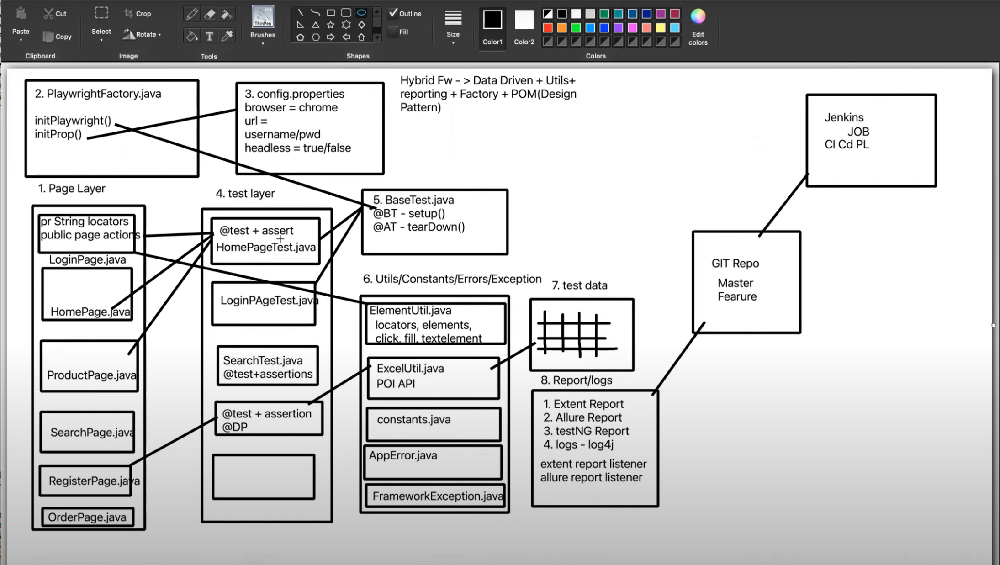

# Playwright Java Automation Framework

## Purpose
A reference web automation framework built with Playwright and Java.
This project demonstrates modern browser automation patterns commonly
used in CI pipelines for functional and regression testing.

## Architecture Overview
The framework follows a layered design:

- Page layer encapsulates locators and page-level actions
- Test layer focuses on assertions and workflows
- Factory and base test layers manage browser lifecycle and configuration
- Utilities handle common interactions, data access, and reporting



## Tech Stack
- Java
- Playwright
- Maven
- TestNG
- Page Object Model (POM)

## How to Run Locally
```bash
mvn clean test
```

## Browser Installation
```bash
mvn exec:java -Dexec.mainClass=com.microsoft.playwright.CLI -Dexec.args="install"
```

## Status

Stable reference implementation.
Primary automation focus has shifted toward cloud-integrated CI pipelines
and Python-based test execution.
